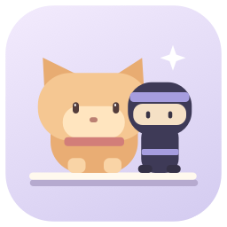
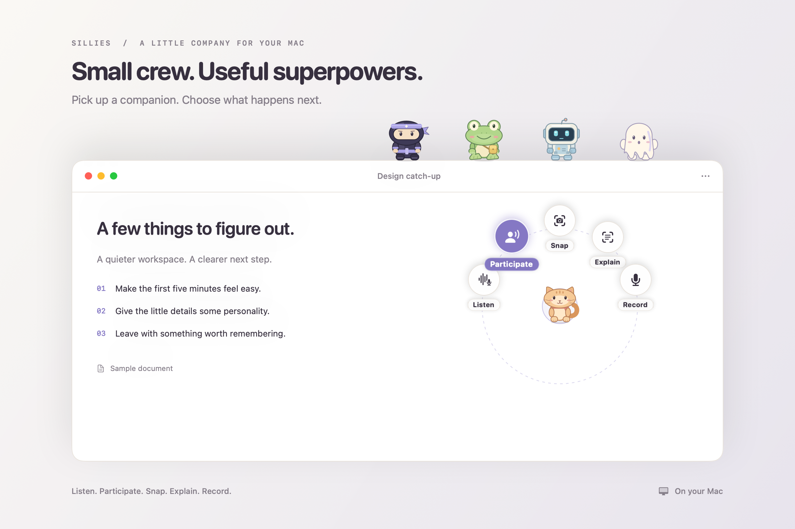
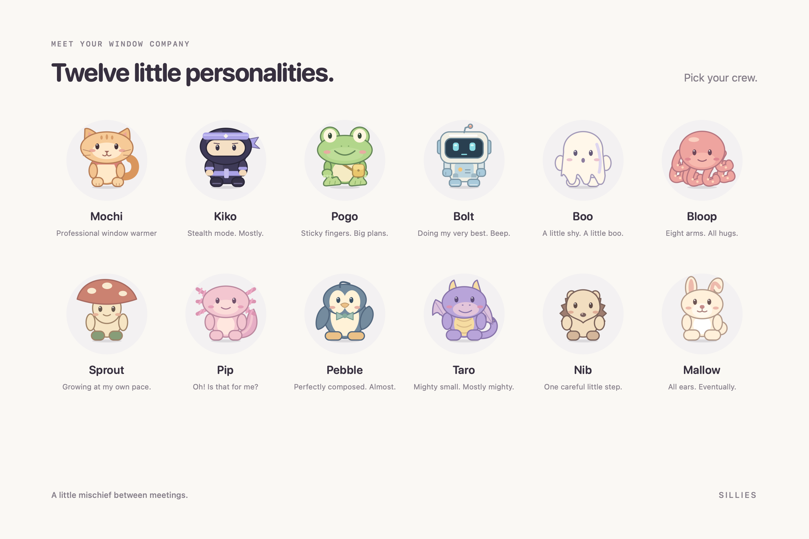
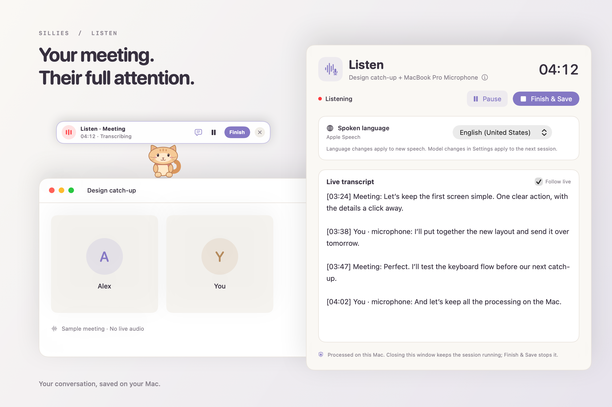

<p align="center">
  
</p>

<h1 align="center">Sillies</h1>

<p align="center">
  <strong>Little companions. Useful superpowers.</strong><br>
  Twelve animated companions that live on your window edges.<br>
  Dictate a thought, capture a meeting, save something for later. All on your Mac.
</p>

<p align="center">
  <a href="#meet-your-crew">The crew</a> ·
  <a href="#give-them-something-to-do">Skills</a> ·
  <a href="#choose-your-local-models">Local models</a> ·
  <a href="#get-started">Get started</a> ·
  <a href="#build-on-sillies">Contribute</a>
</p>

<p align="center"><sub>Native macOS app · Apple silicon · macOS 26+ · No account required</sub></p>

<p align="center">
  
</p>

## Meet your crew

<p align="center">
  
</p>

Mochi naps on the title bar. Kiko takes the dramatic route. Pogo climbs the side of your window.
Bolt is doing his very best. Pick your favorites from twelve companions, each with its own artwork,
personality, and reactions.

They ride along as you move and resize windows. In **Playful** mode, they might dance together, sweep
an edge, throw a paper plane, or gather around a tiny campfire. Choose **Calm**, reduce motion, exclude
an app, or pause the whole crew when you want some quiet.

Sillies lives in the menu bar. Your companions stay outside the window’s content, leaving your work to you.

## Give them something to do

Pick up a companion and hold it over a window. The skill wheel appears; move to an action and release.
Right-click menus and configurable global shortcuts offer the same actions.

| Skill | What happens |
| --- | --- |
| **Listen** | Record app audio and your microphone, follow a live transcript, and save the conversation with notes and action items. |
| **Participate** | Everything in Listen, with suggested questions in your companion’s speech bubble, grounded in the conversation. |
| **Snap** | Capture a window to the clipboard and Vault. Background text recognition makes the screenshot searchable. |
| **Explain** | Read the text in a window screenshot and explain it with your chosen local text model. |
| **Record** | Capture your microphone, with playable audio, a transcript, and notes. |

<p align="center">
  
</p>

Open the transcript when you need it; close it and recording continues. Scroll back or select text without
being pulled to the bottom. **Jump to latest** resumes following. Optional speaker detection helps tell
voices apart, and you can name speakers in saved recordings.

Meeting capture includes the selected app’s audio and your microphone. For browsers, that can include
other tabs playing audio. [Capture details and permissions →](docs/skills.md)

## Speak, write, find it later

- **Dictate into your work.** Hold a shortcut to speak, or toggle listening for a longer thought. A companion
  shows when it is listening. Choose verbatim or lightly cleaned text, and add names and technical terms
  to your personal dictionary. If insertion fails or focus changes, the result stays in Writing recovery.
- **Edit a selection.** Shorten, fix grammar, or translate with a local text model. Inserting text never
  sends a message or runs a terminal command for you.
- **Keep a Pocket Stash.** Drop text, links, or file references onto a companion, or explicitly save the
  clipboard. Search your saved snippets and paste them back into your work.
- **Find it in the Vault.** Search transcripts, notes, and text inside screenshots. Play recordings,
  protect important captures, and export Markdown with attachments. Captures stay until you delete
  them unless you choose a retention limit; writing recovery has its own short history.

[Writing, shortcuts, and recovery →](docs/everyday-workflows.md)

## Choose your local models

Speech recognition and text generation are separate choices. Start with Apple’s on-device models,
or download alternatives in Settings. Install only what you want, switch providers, and remove models
you no longer use. Downloading a model does not select it automatically.

### Speech → words

Settings → **Speech & Meetings**

| Engine | Download | Language controls |
| --- | --- | --- |
| **Apple Speech** | Managed by macOS | Installed languages supported on your Mac |
| **Whisper Large v3 Turbo** | ~630 MB | Multilingual, including English and Romanian; automatic or explicit language |
| **Parakeet Ultra** | ~632 MB | Multilingual, including English and Romanian; automatic detection with language hints |

Optional **Nemotron speaker detection** adds a separate ~102 MB download and works alongside any speech
engine. Speaker labels can be wrong; you can rename speakers per recording. Parakeet’s hints guide the writing
script, so they do not strictly force Romanian over English.

Installed speech models can be checked daily for updates. You choose when to download an update;
validation happens before switching, and the previous version remains available for rollback.

[Speech models, languages, and updates →](docs/local-speech-models.md)

### Words → notes, explanations, and edits

Settings → **Local AI**

| Model | Download | Required memory |
| --- | --- | --- |
| **Apple Intelligence** | Managed by macOS | An eligible Mac with Apple Intelligence enabled |
| **Qwen3.5 4B** | ~3.05 GB | 16 GB |
| **Qwen3.5 9B** | ~5.97 GB | 24 GB |
| **Gemma 4 E4B** | ~5.18 GB | 16 GB |
| **Ministral 3 8B Instruct** | ~5.61 GB | 24 GB |

The downloadable models use 4-bit weights and run natively through MLX. No Python environment or local
server to set up. Memory requirements leave room for transcription and your other apps.

These are multilingual alternatives to Apple’s model, whose available languages depend on your Mac.
Quality and speed vary by model, language, and hardware; downloadable text models are still being
evaluated. Generated notes can make mistakes. When generation fails, Sillies preserves the transcript
and labels extracted highlights separately. Text-model revisions currently ship with app updates.

[Text models, requirements, and evaluation status →](docs/local-text-models.md)

## Your Mac does the work

Audio, screenshots, transcripts, and text inference stay on your Mac. No cloud inference fallback,
account, or telemetry. Internet access is used to download models and check for updates.

Recording starts only when you ask. There is no automatic clipboard history or background collection
of what you type. Basic window companions need no permissions; capture asks for the relevant macOS
permissions, and inserting text requires Accessibility. Settings provides the controls to open those panes.

## Get started

Sillies is under active development. Build from source on an Apple silicon Mac with macOS 26+, Xcode 26+
with Swift 6.2 or later, and Xcode’s Metal toolchain.

```sh
git clone https://github.com/cristipufu/sillies.git
cd sillies
make run
```

Look for the paw in your menu bar. Pick your crew, try a skill, or open **Give them a window to play on**.
Settings organizes companions, writing, speech, local AI, shortcuts, and launch at login.

If the Metal toolchain is missing, install it with `xcodebuild -downloadComponent MetalToolchain`.
Use the built `.app` for permission testing. [Development setup and checks →](docs/development.md)

## Build on Sillies

Bring a new personality, interaction, skill, or local model. Each has a dedicated contributor guide:

Start with [Contributing to Sillies](CONTRIBUTING.md) for setup, bug reports, checks, and pull requests.

| I want to add… | Start here |
| --- | --- |
| **A companion** | [Character packs, artwork, and personality](docs/contributing/companions.md) |
| **An interaction** | [Reactions, animations, and scenes between companions](docs/contributing/interactions.md) |
| **A skill** | [Session lifecycle, commands, UI, and saved results](docs/contributing/skills.md) |
| **A speech model or STT engine** | [Model manifests and speech-provider adapters](docs/contributing/speech-models.md) |
| **A text / LLM model** | [Model manifests and text-provider adapters](docs/contributing/text-models.md) |

An existing animation can become a new reaction through JSON. A compatible model can join the catalog
without new settings UI. New artwork, behavior, and runtimes have their own registration points;
these are source contributions, not downloadable executable plugins.

Keep changes focused: pure behavior and geometry in Core, character choices in packs, and capture,
inference, storage, and presentation behind their own boundaries. Follow [the development contract](AGENTS.md),
preserve cancellation and recovery, and keep work off the UI thread.

```sh
make check BUILD_DIR=/tmp/sillies-check   # Validate without replacing your running app
```

<p align="center">
  <a href="docs/architecture.md">Architecture</a> ·
  <a href="docs/performance.md">Performance</a> ·
  <a href="docs/development.md">Development guide</a> ·
  <a href="docs/extending.md">Detailed character and scene contracts</a>
</p>

<p align="center">
  <a href="CONTRIBUTING.md">Contributing</a> ·
  <a href="SECURITY.md">Security</a> ·
  <a href="PRIVACY.md">Privacy policy</a> ·
  <a href="THIRD_PARTY_NOTICES.md">Third-party notices</a> ·
  <a href="LICENSE">MIT License</a>
</p>

<p align="center"><sub>A little company. A little mischief. Everything local.</sub></p>
