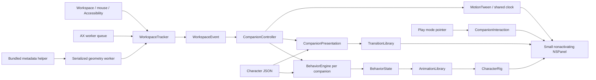

# Architecture

## Data flow

`SilliesCore` has no AppKit objects or timers. Its models are Sendable value types; behavior choices are reproducible from a seed. Each character has an independent cooldown map and active reaction. Highest priority wins; weighted choices create variety among eligible reactions. Only an expired state can select a new ambient action.

`SilliesAudio` is a compiler-enforced target for capture, speech recognition, echo cancellation, and AAC recording. It depends on Core, provider-neutral `SilliesSpeech` contracts, and the vendored audio library; it cannot depend on the app. Package-visible capture/language contracts connect it to app-owned presentation and preferences. Internal DSP and recognizer types are tested in `SilliesAudioTests`. `AudioCaptureInputQueue` bounds admitted PCM by duration, callback count, and 32 MiB of retained sample bytes. Its Mutex owns admission and resource counters. `AudioSessionUpdateDelivery` keeps one pending progress value between lifecycle events and schedules at most one main-run-loop delivery. Stop clears staged updates and queued callbacks hold it weakly.

`WindowTransitionObservation` and `WindowTransitionEvaluation` own pure transition decisions and virtual-time settlement. `WorkspaceTracker` applies those decisions; `WindowTrackingSchedule` owns heartbeat, housekeeping, settlement, transition polling, and discovery slots. `WindowRefreshScope` replaces discovery flags and prevents queued application discovery from overriding a manipulation read.

`SilliesPersistence` is a separate Swift target depending only on `SilliesCore`. `SessionRecordRepository` owns the existing JSON format; `VaultFileStorage` owns atomic writes and attachment removal. Both expose synchronous, throwing operations scheduled by the application's I/O worker. Filenames are validated before I/O and again when decoding attachment references. Absolute paths, dot components, separators, NULs, and attachment references to `sessions.json` are rejected. Cleanup uses file-only unlink, so a directory cannot be recursively removed and a symlink's target is preserved. A missing index is an empty vault; unreadable or malformed metadata is a failed load. `SessionVaultStore` blocks index writes after that failure, preserves pending in-memory edits, and reloads before merging and saving on retry. It never replaces a failed read with an empty successful result.

`CompanionSurfacePlacement` performs one placement transaction using an immutable environment snapshot. Pending placements belong to that transaction, while `CompanionInstance` owns private motion, pickup, attachment, and behavior state. Callers request transitions instead of mutating those fields. `PerchAttachmentChange` preserves normalized slots and classifies attachment changes; `PerchSettlement` owns settling distances and timing. Both are pure core models. Window transition state, click-selection expiry, geometry speeds, and canonical frame comparison also live in `SilliesCore`; timers, notifications, and native panels remain in the platform/application layer.

`CompanionController` owns the session. It reconciles enabled characters, routes events, places feet or hands on safe surfaces, and delegates scheduling to `CompanionDeadlineClock` and `CompanionMotionClock`. `CompanionSkillControls` owns HUD actions, menus, and stash feedback. Stop invalidates pending feedback generations, so an old save cannot reopen overlays after pause or shutdown. `SkillPresentation` carries presentation data; the controller never reaches through HUD models, rigs, or the skill coordinator's vault. Each companion owns its own small window and rig; it does not own a timer. When a state expires on a side, the engine selects from the pack's `ambient.wall` reactions, falling back to ordinary `ambient` for packs without wall overrides.

`CompanionMotionClock` synchronizes travel with the active display and samples tweens at the next presentation deadline. It also samples deliberate pickup gestures between mouse events; duplicate pointer positions do no work. A screen display link lets offscreen returns continue. Pause, exclusions, an empty crew, and termination invalidate the link. No clock runs for static poses or finite Core Animation clips alone.

`WorkspaceTracker` (`WindowTracking.swift`) converts macOS signals into bounded event rates. `WindowServerSource` reads public window geometry on a worker queue; it does not capture pixels or request Screen Recording. Normal window following works without Accessibility. A shared heartbeat samples the known focused window at 4 Hz when AX is unavailable (1 Hz with AX); full discovery is limited to focus changes and periodic reconciliation. It observes the active application, never an inventory of every UI tree. A context event means a supported selection/title notification arrived; it is not a guarantee that a browser tab changed. Window titles and document contents are not read.

Window metadata reads run in the bundled `SilliesWindowMetadata` helper process. Background threads in the UI process still share a WindowServer connection lock with Core Animation; a window-list read can otherwise stall an animation commit for about 500 ms. Existing worker queues use bounded pipe requests, while `WorkspaceTracker` owns the helper lifetime through pause, exclusions, sleep, and termination. Replies carry the helper's monotonic capture timestamp. Errors preserve the last verified geometry; the next request can restart a failed helper. No AppKit or Core Animation is initialized in that process. `WindowMetadataClient` owns leases and reconnection, `WindowMetadataConnection` owns pipe I/O, and `WindowMetadataWire` owns the shared response format. A valid empty snapshot is distinct from a failed read.

Native Sillies windows publish their actual frame synchronously from AppKit move/resize notifications. For another app, `PointerWindowGesture` anchors a move or edge/corner resize to the original mouse-down location and window bounds, coordinated by `ForeignWindowDragTracker`. `WindowDragSession` starts pending: a header may contain controls, text, or a non-draggable custom element. Targeted metadata at up to 60 Hz must first prove actual window movement consistent with the pointer. An attempted drag that leaves the window stationary never moves companions or their document mask.

After confirmation, one temporary screen display link samples the current pointer at display cadence, capped at 60 Hz in Low Power Mode. Raw drag events also update attachment. Metadata validates predictions at 10 Hz, with at most one read pending. History covers 0.8 seconds rather than a fixed event count, so duplicate callbacks and high refresh rates do not erase validation history prematurely. A sustained mismatch switches to bounded 60 Hz metadata for the rest of the held drag, preserving responsive tracking for constraints or snapping. It never drops an active drag to the 4 Hz idle heartbeat. Release briefly holds a confirmed final pointer frame while reconciliation catches up. Pause, sleep, exclusions, focus changes, and termination cancel active gesture work.

The shared settle deadline uses a timer in common run-loop modes so native tracking/animation loops can deliver the landing reaction. The integration check waits for the actual settle event and a new landing after resize, with a bounded timeout.

`AccessibilityWindowSource` confines AX objects to a serial worker queue. The observer's main-run-loop callback only queues work. AX messaging has a short timeout. A lock-protected gate bounds pending geometry reads to one; slow apps cannot accumulate an unbounded backlog. Published observations are immutable, and the main actor rejects observations from a no-longer-active process.

`DragWindowSnapshot` reads a bounded, front-to-back window stack on a serial worker at pickup and on focus/stack invalidation. Drag hit testing uses cached rectangles instead of synchronous WindowServer calls. Known frame updates are merged into in-flight snapshots. `DragWindowTargetResolver` coalesces single-window metadata queries, caches results briefly, and rejects stale session/point replies. Mouse-up validates the native window only for an explicit radial skill selection. A release without a choice simply clears the overlays and returns to the original perch, without creating a skill bar or scheduling another target lookup. The cancellable arrival callback starts the selected skill after the return transition.

`WindowTargetCache` owns role snapshots, candidate entries, and pending refresh generations inside a Swift `Mutex`. No metadata IPC runs under that lock. New authoritative observations invalidate older refreshes; transient failures preserve the last verified roles with a retry backoff. Native overlay panels explicitly join all applications, matching their cross-application purpose, and frame placement uses `display: false`.

`ApplicationIconCache` loads and rasterizes icons off the main actor, keeping bounded 64×64 bitmaps for views to read. The shared highlight and radial wheel prepare hidden views before input is enabled and reuse their panels. The highlight is a native outline plus a small SwiftUI badge, without a window-sized tint or changing terminal-title layout. Unchanged frame/model values and redundant hidden-window ordering are skipped. Dwell begins at valid target entry, and system popup animations are disabled. None of these services adds a polling timer or drives mascot movement.

`CompanionHUDController` owns panel placement and cached card sizing. Its SwiftUI view receives a binding-state value alongside action callbacks, so explicit sizing sees the latest text immediately. `NSHostingController.sizeThatFits(in:)` measures only when the layout key changes; automatic hosting constraints and forced subtree rendering are unnecessary. The model, view, and controller live in separate files.

`SessionVaultModel` owns search/filter selection, save/undo/delete commands, and cancellable feedback. `SessionRecordSearch` and `StashContents` keep reusable decisions in Core. Sidebar, detail content, and detail header render in separate view types. Saving a stash clears an unrelated search so the new record is visible; deleting it selects the adjacent visible record. Closing the view cancels feedback and clears preview pinning.

`RendererRegistry` maps character-pack renderer identifiers to rig factories. `AnimationLibrary` resolves shared clips, registered pose variants, and character-specific overrides. `BuiltinAnimations` defines the shared clips separately from that resolution policy. Character drawing knows nothing about events; behavior selection knows nothing about CALayer. The initial rigs share named head/limb/face anchors, so common clips work on either body.

`CompanionPresentation` owns entry, exit, reattachment, and their cancellation. `TransitionLibrary` supplies finite clips selected by the pack's optional `transitions` profile. These animate an outer presentation layer; behavior resets affect only the inner rig. Geometry updates never wait for a transition. Generation tokens reject stale completion callbacks when an exit is interrupted by a new attachment. Losing an attachment plays an exit; pause, exclusions, disabling a character, unsafe placement, and termination hide immediately. Reduced motion skips transition animation. Completion callbacks replace additional application timers.

Behavior preparation preserves continuous window inertia; a full stop resets both. This keeps the landing spring alive when a settling reaction starts, while hidden characters stop all rig animations.

`BehaviorPlayback` owns continuity across reconciliation: the same behavior, pose, and motion policy keep their current clip. `CharacterRig.behaviorResetGeneration` invalidates that cached state after hiding or custom rig resets. `WindowFeedbackAnimation` evaluates interrupted lean/stretch motion and settling analytically in `SilliesCore`, so retargeting never needs synchronous presentation-tree readback.

`MainRunLoopDelivery` delivers metadata and finite completions across common, tracking, and modal run-loop modes. `SessionVaultStore` reads and decodes saved sessions on its I/O worker, then merges early additions/deletions before persisting. Initial-load completion participates in the same modal-safe termination flush; views never wait synchronously for vault I/O.

The vault delegates preview eviction and byte accounting to `VaultImageCache`, worker image conversion to `VaultImageCodec`, asynchronous clipboard ownership to `VaultClipboard`, and cancellable note generation to `VaultSummaryScheduler`. The scheduler rejects cancelled or replaced results; only the store merges completed notes into current records. `VaultPreviewBuffer` uses a lock to stage worker results that can also be drained during modal termination.

Audio producers and presenters exchange `AudioCaptureUpdate`, `AudioCaptureConfiguration`, and `AudioCaptureResult` through `SessionAudioCapture`. These contracts do not reference the concrete capture service. `SessionSpeechPipeline` and `SpeechChannelGroup` use checked Sendable conformance; their private mutable state is confined by the audited `SerialQueueStorage` adapter, which asserts the owning serial queue at every access. `AudioSessionUpdateDelivery` instead protects its pending messages with a lock and delivers only on the main actor.

See [development.md](development.md) for ownership boundaries and the checks expected when changing them.

The controller accepts `CompanionAssets` (catalog, renderer registry, behavior clips, and transitions) and `CompanionServices` (native-access policy, skills, and additional event producers) at construction. Startup wires named event handlers; geometry publication explicitly distinguishes manipulation from reconciliation. The bundled defaults keep normal startup simple; extensions and tests can supply their own registrations. Catalog validation checks data, duplicate identities, renderers, behavior clips, and transition references before panels appear.

Settings and UI use Observation. Animation position is deliberately kept out of observed SwiftUI state: moving a character must not rebuild the menu-bar interface every frame.

## Permissions and privacy

Accessibility is optional and requested only by the user's enable action. Normal window following does not request Screen Recording or Input Monitoring. Accessibility is an optional enhancement, not a prerequisite for window-edge placement. Mouse events are observed for dragging/scrolling; keyboard contents are never captured. Idle detection queries elapsed time since input. Explicit productivity skills run only after a user chooses them. Snap captures a single window without OCR; Explain adds worker-based Vision recognition and local reasoning. ApplicationAudioSource and MicrophoneAudioSource are independent capture producers; AudioTranscriptionService coordinates bounded buffers, local SpeechAnalyzer, and AAC file finalization. LocalReasoningService serializes bounded on-device Foundation Models requests. Record has no window binding. SessionVaultStore stores audio, images, transcripts, and notes locally; deliberate stashes are exempt from history trimming. See [skills.md](skills.md).

Window overlays cannot become key or main. They ignore mouse input until Play mode is enabled. Panels are then ready before the pointer arrives: WindowServer's native alpha hit testing passes transparent canvas through, avoiding an asynchronous hover requirement before the first character click. `CompanionView` validates filled artwork again on mouse-down and anchors pickup to that event's actual location.

The focused document and its 10-point exterior resize strip remain protected. Native `NSWindow.windowNumber(at:belowWindowWithWindowNumber:)` identifies the actual window beneath the artwork. `WindowInputRegion` reserves the top 64 points and 10-point resize borders of other application windows; it allows deliberate Play input over background document content. Unknown windows remain protected until their geometry is known. Geometry and background IDs come from existing metadata discovery, with no per-frame window-list scan. Desktop mode requests one snapshot on enabling interaction. An already deliberate pickup can continue across other windows. One pair of event monitors serves the crew and stops outside Play mode, on pause/exclusion, and at termination. Exiting companions pass input through immediately. Companion settings live in UserDefaults; activity and window observations are not persisted.

Unavailable surfaces have no meaningful normalized position. On return to a usable perch, companions use distinct slots distributed by crew size, instead of all inheriting a degenerate path's midpoint. Valid existing positions continue to follow their previous normalized anchor.

## Exterior placement

`PerchSurface` represents an oriented top/left/right ledge with a normalized anchor and outward normal. It chooses the actual top boundary when there is room, compacting gently down to a readable minimum. With insufficient headroom, it chooses an exterior side. A full-bleed window has no available exterior surface; the crew waits instead of covering content or silently returning to the floor.

`AttachmentPose` selects the contact point: feet at `(64, 20)` for standing, upper hand at `(112, 101)` or `(16, 101)` for hanging. Side bodies stay upright. A shared hanging rig supplies raised arms and grips; normal standing arms and the floor shadow disappear. Climbing combines vertical travel with secondary-hand movement and alternating foot kicks. The upper grip stays fixed while body inertia and dangling animate separately. Moving/resizing updates the contact point directly. Hops use the surface outward normal. A reused per-panel mask subtracts the actual focused-window rectangle and clips to the display work area.

`CompanionWindowLayout` also crops the native panel itself to the exterior of the attached top/left/right edge. The transparent native window therefore cannot cover the focused title bar, even during decorative effects. The rig and outer transition layer pivot at the layout's local contact offset, which need not be the canvas center. Deliberate pickup temporarily restores the full animation canvas; release restores exterior native bounds immediately. The layer mask remains responsible for visual document/display clipping during pickup.

Surface updates share a per-pass display visible-frame snapshot across companions; no long-lived screen-frame cache can hide Dock or menu-bar changes.

Switching to another window changes the attachment with a short appearance clip. Characters do not travel through the document to get there.

## Code design rules

Clean Code principles guide implementation: intention-revealing names, focused responsibilities, explicit dependencies, validation at boundaries, and tests of observable behavior. Core decisions stay independent of platform details; platform tracking stays independent of character identities. Extension points exist where variation is already required: artwork, reactions, clips, pose variants, and presentation transitions. No dependency-injection framework or hierarchy of speculative interfaces is needed.

The current architecture is suitable for additional bundled vector characters and reactions. It is not yet a general animation-authoring product. New anatomy still needs a rig that meets the named-part and contact-anchor contract; sprite imports, transition choreography across multiple windows, and a timeline editor are separate capabilities. The session controller still coordinates placement and shared scheduling; extract another component when a concrete feature makes one of those responsibilities change independently.

Meeting capture uses `MeetingAudioTimeline` in SilliesCore for bounded sample-time pairing and `MeetingAudioProcessor` on the audio worker for resampling, WebRTC AEC3, and recording mixdown. The vendored C bridge has no device or networking API. Listen and Participate share this path; only Participate generates suggestions. `MeetingSpeechBubbleController` owns its single nonactivating panel and finite content animation, while `SuggestionBubbleLayout` owns screen-constrained geometry. The HUD lifecycle hides and closes the bubble with its companion.

At the audio window's minimum size, language controls, notices, and meeting suggestions can scroll independently when their combined height exceeds the available space. The header, finish controls, transcript viewport, and footer remain inside the window. `ViewThatFits` is confined to these short controls; it never measures or wraps the live native transcript. Failure-state guidance asks the user to save the available recording instead of claiming capture is still running.

## Lifecycle ownership

`WorkspaceNotifications` owns native subscriptions, `WorkspaceInputMonitor` owns mouse monitors, and `WorkspaceFocusSession` owns application identity and pending-discovery continuity. Native move/resize callbacks remain synchronous. `WorkspaceTracker` composes those owners with the existing pure transition policy and scheduler; fresh observation generations reject callbacks from stopped sessions, including housekeeping completions.

`AudioSessionLifecycle` represents idle, preparing, capturing, paused, failed, finishing, and finished states with explicit transitions and monotonic time inputs. Duplicate startup cannot replace an active capture. Multiple finish callers share one resource drain; each audio/speech source completes once, and later subscribers receive the cached result. A bounded finalization lease retains the service through draining and releases it on completion or deadline. Startup tasks do not retain the whole service across native device permission waits.

Capture, microphone, speech-pipeline, and recognizer-group mutable state is private to `SerialQueueStorage`. Its one audited unchecked adapter asserts the owning serial queue for every access, allows only Sendable return values, and never blocks via synchronous dispatch. Callers must provide a serial queue and must not let its state escape. The coordinating types use checked Sendable conformance. Window request scheduling and metadata-client ownership instead use compiler-checked Mutex state; slow socket I/O uses a separate worker-only request lock so main-thread stop remains independent.

## Failure and recovery contracts

`SessionFailure` carries a category, message, and optional recovery action from capture through presentation and persistence. Permission decisions never inspect summary or diagnostic wording. Microphone denial comes from the device authorization result; application-audio denial is mapped from ScreenCaptureKit's error domain/code. Live and saved sessions share `SessionFailureNotice`, and `SessionRecovery` opens the specific permission pane. Existing summaries remain visible even when a session failed.

`SessionRecord+Codable` preserves existing keys and writes the legacy `failureMessage` alongside the optional typed `failure` value for older readers. Legacy decoding recognizes only specific historical failure markers, never summary text; other messages remain visible as unknown failures without a permission action. Fixed JSON fixtures in the persistence tests preserve historical fields, dates, identifiers, and missing-field defaults independently of today's encoder. This is an additive format extension; incompatible changes require an explicit migration/versioning design.

`SessionRecord` construction takes the skill kind plus `SessionOrigin`, `SessionContent`, and `SessionMetadata`. Content groups source text, notes, attachments, and processing state; these are construction values, not a replacement disk schema. `SessionMarkdownFormatter` owns export section order and formatting, with a supplied locale for deterministic checks.

Failure decoding retains category and recovery identifiers verbatim. Unknown categories present as `.unknown`; recovery is offered only for a recognized permission-denied category and action. Unknown actions remain inert, and their identifiers survive saving so a newer reader can recover them. Missing required fields and incorrect JSON types still fail decoding rather than masking corrupted storage.

## Downloadable speech models

`SilliesSpeech` owns language/channel/provider contracts, bounded audio windows, word-time reconciliation, and serialized inference. `SilliesAudio` receives a channel factory and never imports an inference SDK. `SilliesSpeechApple`, `SilliesSpeechWhisper`, and `SilliesSpeechParakeet` adapt their respective SDKs. SDK-specific state stays inside those targets.

`SilliesModelStore` owns the pinned artifact catalog, asynchronous downloads, SHA-256 verification, atomic staging/version selection, rollback, installation leases, and bounded upstream update discovery. `SilliesModelValidation` owns worker-only Core ML interface comparison before provider inference validation. Its actor performs filesystem operations away from the UI. `SpeechRuntimeRegistry` composes providers, shares one preparation and loaded runtime across the session's sources, and cancels preparation once no consumer needs it. Model selection is captured at session startup; changing Settings affects the next session.

The main actor owns only settings/session presentation. Model files, tokenizer parsing, model specialization, inference, and audio conversion stay on workers. Worker-entry assertions are enforced by the architecture checker. Download progress uses one bounded stream and one delivery task; audio input uses one consumer per source. Models retain a 12-second recognition window and at most 24 seconds of queued audio per source, independent of recording length. One shared inference scheduler prevents overlapping predictions against the same weights. Overload stops transcription with an explicit notice while recording continues.

See [local speech models](local-speech-models.md) for extension rules, validation, and diarization/update considerations.

Speaker detection uses provider-neutral contracts in `SilliesSpeech` and an isolated `SilliesDiarizationNemotron` adapter. `SessionDiarization` owns bounded per-source activity and pending phrase attribution independently of recognizer language generations. The existing channel group owns its asynchronous drain/cancellation. Domain speaker labels and overlap decisions stay in Core.

## Finite playful choreography

`PlayfulSceneDirector` chooses validated catalog scenes using seeded selection, bounded recent history, and cooldowns. `PlayfulSceneLayout` reserves safe routes around available perches and occupied companion frames; `PlayfulSceneSession` samples the entire cast from one monotonic timeline. These are pure Core models. `PlayfulSceneMotion` supplies bounded cast displacement and canopy banking from the same phase progress, so travel stays connected to the prop. Pack data supplies scene participation, clip overrides, and sign messages.

`PlayfulSceneCoordinator` owns a single active session and a compact shared prop presenter. It delegates scene entry, placement, cancellation, and restoration to `CompanionInstance`. `CompanionController` supplies opportunities and cancels before native geometry reconciliation. Geometry cancellation marks the original perch for the next placement pass, avoiding a separate intermediate native placement. Pickup preserves the current scene point and original normalized return slot.

The coordinator contributes deadlines and motion demand to the existing shared clocks. Stationary dances and expressions remain compositor-driven. Traveling actors and the small paper-plane panel reuse the shared display link and only change native frames when their position changes. Phase changes apply pose, crop, artwork, and props in one layer transaction. Crop changes during corner travel also apply native placement and rig layout atomically: the pull-up switches to top clipping after the feet clear the ledge, and voluntary lowering reverses the same path into side clipping before descending. Ordinary travel avoids extra transaction commits, and exterior panels retain constant bounds across grip changes. Shared props reuse artwork and measured text. Border climbing uses the normal side grips without a shared prop or additional native window. Pause, exclusions, skill use, and stop cancel the timeline and hide props; stop closes the panel and releases its tracking exclusion. A subsequent start re-registers it.

`PlayfulArticulation` owns temporary joint pivots; authored scene poses reuse the existing side-climbing grip without changing the tracked surface. `PlayfulRigProps` owns handheld artwork; shared scene artwork and native prop presentation have separate owners. Behavior reset restores all joints and decorations. `MascotBubbleContour` defines pure curved-tail geometry, and `MascotBubbleArtwork` provides the common light/dark material for speech suggestions and playful notes. Meeting suggestions retain cached text measurement and one input-transparent native panel above the companion layer. All playful text goes through `PlayfulMessageArtwork`, including protest and scoreboard. The broom owns one paired tool/hand/forearm animation cycle. Flexible sleeves and rounded hands are shared by the broom, tug, shove, and clamber; pure clamber motion coordinates body travel and hand placement around the corner, and the campfire owns a bounded set of flame, glow, and ember layers.
