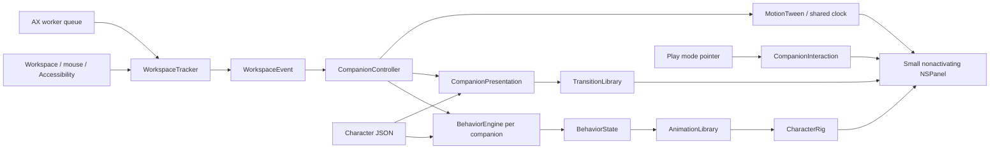

# Architecture

## Data flow

`SilliesCore` has no AppKit objects or timers. Its models are Sendable value types; behavior choices are reproducible from a seed. Each character has an independent cooldown map and active reaction. Highest priority wins; weighted choices create variety among eligible reactions. Only an expired state can select a new ambient action.

`CompanionController` owns the session. It reconciles enabled characters, routes events, places feet or hands on safe surfaces, and owns two shared scheduling mechanisms: a single next-decision deadline and a single movement clock. Each companion owns its own small window and rig; it does not own a timer. When a state expires on a side, the engine selects from the pack's `ambient.wall` reactions, falling back to ordinary `ambient` for packs without wall overrides.

`WorkspaceTracker` (`WindowTracking.swift`) converts macOS signals into bounded event rates. `WindowServerSource` reads public window geometry on a worker queue; it does not capture pixels or request Screen Recording. Normal window following works without Accessibility. A shared heartbeat samples the known focused window at 4 Hz when AX is unavailable (1 Hz with AX); full discovery is limited to focus changes and periodic reconciliation. It observes the active application, never an inventory of every UI tree. A context event means a supported selection/title notification arrived; it is not a guarantee that a browser tab changed. Window titles and document contents are not read.

Native Sillies windows publish their actual frame synchronously from AppKit move/resize notifications. For another app, `PointerWindowGesture` anchors a move or edge/corner resize to the original mouse-down location and window bounds, coordinated by `ForeignWindowDragTracker`. `WindowDragSession` starts pending: a header may contain controls, text, or a non-draggable custom element. Targeted metadata at up to 60 Hz must first prove actual window movement consistent with the pointer. An attempted drag that leaves the window stationary never moves companions or their document mask.

After confirmation, one temporary screen display link samples the current pointer at display cadence, capped at 60 Hz in Low Power Mode. Raw drag events also update attachment. Metadata validates predictions at 10 Hz, with at most one read pending. History covers 0.8 seconds rather than a fixed event count, so duplicate callbacks and high refresh rates do not erase validation history prematurely. A sustained mismatch switches to bounded 60 Hz metadata for the rest of the held drag, preserving responsive tracking for constraints or snapping. It never drops an active drag to the 4 Hz idle heartbeat. Release briefly holds a confirmed final pointer frame while reconciliation catches up. Pause, sleep, exclusions, focus changes, and termination cancel active gesture work.

The shared settle deadline uses a timer in common run-loop modes so native tracking/animation loops can deliver the landing reaction. The integration check waits for the actual settle event and a new landing after resize, with a bounded timeout.

`AccessibilityWindowSource` confines AX objects to a serial worker queue. The observer's main-run-loop callback only queues work. AX messaging has a short timeout. A lock-protected gate bounds pending geometry reads to one; slow apps cannot accumulate an unbounded backlog. Published observations are immutable, and the main actor rejects observations from a no-longer-active process.

`RendererRegistry` maps character-pack renderer identifiers to rig factories. `AnimationLibrary` resolves shared clips, registered pose variants, and character-specific overrides. `BuiltinAnimations` defines the shared clips separately from that resolution policy. Character drawing knows nothing about events; behavior selection knows nothing about CALayer. The initial rigs share named head/limb/face anchors, so common clips work on either body.

`CompanionPresentation` owns entry, exit, reattachment, and their cancellation. `TransitionLibrary` supplies finite clips selected by the pack's optional `transitions` profile. These animate an outer presentation layer; behavior resets affect only the inner rig. Geometry updates never wait for a transition. Generation tokens reject stale completion callbacks when an exit is interrupted by a new attachment. Losing an attachment plays an exit; pause, exclusions, disabling a character, unsafe placement, and termination hide immediately. Reduced motion skips transition animation. Completion callbacks replace additional application timers.

Behavior preparation preserves continuous window inertia; a full stop resets both. This keeps the landing spring alive when a settling reaction starts, while hidden characters stop all rig animations.

The controller accepts a catalog, renderer registry, behavior animation library, and transition library at construction. The bundled defaults keep normal startup simple; extensions and tests can supply their own registrations. Catalog validation checks data, duplicate identities, renderers, behavior clips, and transition references before panels appear.

Settings and UI use Observation. Animation position is deliberately kept out of observed SwiftUI state: moving a character must not rebuild the menu-bar interface every frame.

## Permissions and privacy

Accessibility is optional and requested only by the user's enable action. Normal window following does not request Screen Recording or Input Monitoring. Accessibility is an optional enhancement, not a prerequisite for window-edge placement. Mouse events are observed for dragging/scrolling; keyboard contents are never captured. Idle detection queries elapsed time since input. Explicit Drop-to-Bind productivity skills (`WindowSnapshotService` for single-window snapshots/Vision OCR and `AudioTranscriptionService` for isolated window/app audio + on-device `SFSpeechRecognizer`) run only when initiated by the user and store their outputs locally in `SessionVaultStore` with no network services.

Window overlays cannot become key or main. They ignore mouse input until Play mode is enabled. Panels are then ready before the pointer arrives: WindowServer's native alpha hit testing passes transparent canvas through, avoiding an asynchronous hover requirement before the first character click. `CompanionView` validates filled artwork again on mouse-down and anchors pickup to that event's actual location.

The focused document and its 10-point exterior resize strip remain protected. Native `NSWindow.windowNumber(at:belowWindowWithWindowNumber:)` identifies the actual window beneath the artwork. `WindowInputRegion` reserves the top 64 points and 10-point resize borders of other application windows; it allows deliberate Play input over background document content. Unknown windows remain protected until their geometry is known. Geometry and background IDs come from existing metadata discovery, with no per-frame window-list scan. Desktop mode requests one snapshot on enabling interaction. An already deliberate pickup can continue across other windows. One pair of event monitors serves the crew and stops outside Play mode, on pause/exclusion, and at termination. Exiting companions pass input through immediately. Companion settings live in UserDefaults; activity and window observations are not persisted.

Unavailable surfaces have no meaningful normalized position. On return to a usable perch, companions use distinct slots distributed by crew size, instead of all inheriting a degenerate path's midpoint. Valid existing positions continue to follow their previous normalized anchor.

## Exterior placement

`PerchSurface` represents an oriented top/left/right ledge with a normalized anchor and outward normal. It chooses the actual top boundary when there is room, compacting gently down to a readable minimum. With insufficient headroom, it chooses an exterior side. A full-bleed window has no available exterior surface; the crew waits instead of covering content or silently returning to the floor.

`AttachmentPose` selects the contact point: feet at `(64, 20)` for standing, upper hand at `(112, 101)` or `(16, 101)` for hanging. Side bodies stay upright. A shared hanging rig supplies raised arms and grips; normal standing arms and the floor shadow disappear. Climbing combines vertical travel with secondary-hand movement and alternating foot kicks. The upper grip stays fixed while body inertia and dangling animate separately. Moving/resizing updates the contact point directly. Hops use the surface outward normal. A reused per-panel mask subtracts the actual focused-window rectangle and clips to the display work area.

`CompanionWindowLayout` also crops the native panel itself to the exterior of the attached top/left/right edge. The transparent native window therefore cannot cover the focused title bar, even during decorative effects. The rig and outer transition layer pivot at the layout's local contact offset, which need not be the canvas center. Deliberate pickup temporarily restores the full animation canvas; release restores exterior native bounds immediately. The layer mask remains responsible for visual document/display clipping during pickup.

Switching to another window changes the attachment with a short appearance clip. Characters do not travel through the document to get there.

## Code design rules

Clean Code principles guide implementation: intention-revealing names, focused responsibilities, explicit dependencies, validation at boundaries, and tests of observable behavior. Core decisions stay independent of platform details; platform tracking stays independent of character identities. Extension points exist where variation is already required: artwork, reactions, clips, pose variants, and presentation transitions. No dependency-injection framework or hierarchy of speculative interfaces is needed.

The current architecture is suitable for additional bundled vector characters and reactions. It is not yet a general animation-authoring product. New anatomy still needs a rig that meets the named-part and contact-anchor contract; sprite imports, transition choreography across multiple windows, and a timeline editor are separate capabilities. The session controller still coordinates placement and shared scheduling; extract another component when a concrete feature makes one of those responsibilities change independently.
