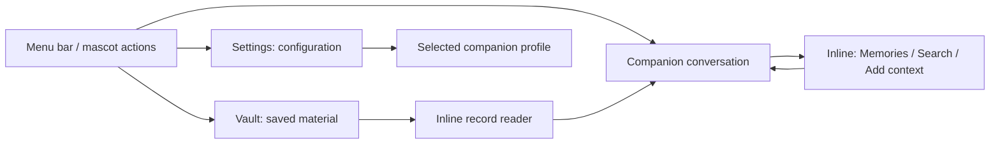

# Window, navigation and layering review

**Date:** 6 November 2026

**Baseline:** `aafcedabc87eff9e20beec9e3550748d7fed248e`, plus the Memories presentation fix described below.

**Scope:** production windows, Settings and its subpages, dialogs, popovers, companion panels, control bars, thoughts, writing tools, Vault and Chat navigation.

**Status:** the P1/P2 changes are implemented. Headless validation is complete; visible native checks remain opt-in.

## Baseline assessment

Sillies has a recognizable visual language: warm surfaces, companion artwork, rounded controls and
compact speech bubbles. Settings already uses a single window, and the recording controls and thoughts
already share their companion's native stacking level. Those are good foundations.

The initial review found inconsistent window ownership and navigation: routine Chat tasks used modal sheets over a transparent bubble,
some feedback panels sat above unrelated app content, and reopening the Vault replaced its view state.

Keep Settings and Vault as separate, reusable destinations. Keep companion tasks with the companion.
Reduce automatic secondary windows and preserve the user's place when navigating. A literal count of
native windows is not a useful target: twelve mascot panels are intentional; a second reader that
appears unexpectedly or loses its owner is not.

### Evidence and limits

- **Confirmed:** presenter code, ownership, configured window levels, navigation paths and headless
  regression behavior were inspected.
- **Rendered:** all ten Settings destinations were rendered in light and dark appearances at their
  minimum size; representative previews were visually inspected. Chat utility pages were rendered
  inside the real bubble shape at minimum size. These utility captures cover initial loading/empty
  states and the populated memory editor; they do not prove every populated, paginated list layout.
  Other session/utility previews supplement the review.
- **Inferred:** the reported Memories rectangle matches native sheet-parent dimming. The exact
  WindowServer pixels from the user's running app were not reproduced during this headless pass.
- **Not certified:** live overlap with other apps, full-screen/Spaces transitions, multi-display
  ordering, VoiceOver navigation and all 22 translated layouts. These require the bounded native
  workflow pass below. A passing rendered-view test does not certify native window behavior.

## Fixed in this change: Memories and Chat utilities

The Memories view already painted an opaque theme surface. Its presentation was the mismatch:
`ChatSessionView` opened native sheets from a borderless, transparent window whose visible content is
a shaped conversation bubble. macOS sheets dim their parent. Apple's documentation also specifies that
macOS sheet backgrounds are opaque; changing the inner view's fill would not remove the parent's
rectangular dimming. This is the likely explanation for the reported extra background.
([Apple sheet guidance](https://developer.apple.com/design/human-interface-guidelines/sheets),
[presentation background behavior](https://developer.apple.com/documentation/swiftui/view/presentationbackground(_:)))

Memories, conversation search, Add from Vault and the memory editor now occupy the existing Chat
bubble. Utility pages have a Back action; memory editing keeps Cancel and Save. There is no additional
native sheet or child window for these four routes.

The conversation remains mounted underneath, preserving the draft, viewport and native text selection.
Its text views are hidden and relinquish keyboard focus while a utility page is open. The session's
availability task stays on the stable root; changing pages does not own capture or inference. The
memory form scrolls independently of its fixed Save/Cancel controls at the minimum bubble size.

Outside-click dismissal pauses while a utility task is open, preserving the previous sheet's task
protection. Back resumes ordinary conversation dismissal. Export file choosers and destructive
confirmations remain intentional modal operations; this change does not claim to eliminate all
native modal UI.

Implementation: [Chat navigation](../../Sources/SilliesApp/UI/ChatWindowNavigation.swift),
[Chat root](../../Sources/SilliesApp/UI/ChatSessionView.swift),
[native text visibility](../../Sources/SilliesApp/UI/NativeTextVisibility.swift),
[regressions](../../Tests/SilliesAppTests/ChatPageNavigationTests.swift).

## Surface inventory

| Surface | Baseline presentation / ownership | Target behavior |
| --- | --- | --- |
| Menu-bar Control Center | One `NSPopover`; explicit outside-click/Escape monitors | Quick actions and current activity; dismiss before opening a destination. Keep detailed configuration in Settings. |
| Status-item context menu | Native `NSMenu` | Keep native menu semantics and the same command dispatcher. |
| Settings | One reusable titled window; ten inline destinations | Keep one window. Improve grouping and direct navigation to a selected companion. |
| Setup | Steps inside Settings, with a fixed action footer | First-use guidance or explicit revisit; ordinary companion settings should not reopen the wizard. |
| Companion profiles / model configuration | Inline Settings cards, pickers and disclosures | Keep inline; expose selected/effective settings clearly. No new model-manager window. |
| Settings diagnostics export | Native Save panel; parent inferred from the current key window | Parent explicitly to Settings; one chooser per export owner. |
| Vault | One native window, but a new root/model on each open | Reuse the model and view; navigate to requested records without resetting unrelated state. |
| Vault record details / conversations | Split detail pane and a separate Conversations tab | Preserve query, selection, tab and reading position across close/reopen and cross-links. |
| Add text/link and retention | Native sheets from the opaque Vault window | Reasonable scoped tasks. Keep parent theme and clear dismissal; consolidate retention with data controls through links. |
| Saved transcript reader | Extra titled window owned by a Vault presentation model | Prefer an expanded inline reader; make pop-out explicit, reusable and owned independently of a replaceable view. |
| Chat | One shared anchored, shaped window | Keep attached to the companion; preserve the conversation when hidden or switching utility pages. |
| Memories / memory editor / conversation search / Vault picker | Now pages inside Chat | Keep this pattern; no routine native sheets over the transparent bubble. |
| Chat ideas / reply details | Small contextual popovers | Keep brief and anchored; put long content in an existing reading surface. |
| Live Listen / Participate / Record details | Reusable titled `CompanionUtilityWindow`; fixed elevated level | Ordinary readable content window; closing details must leave recording running. Match native chrome to the app theme. |
| Talk transcript | The Chat bubble while Talk owns the session | Presentation only; opening/closing must not stop Talk or start another capture. |
| Talk / recording controls | Nonactivating compact bubble with tail | Same native level as its mascot, immediately above it. Follow the host; never remain alone above an occluding window. |
| Participate thought | Passive bubble, same level as mascot; control collision avoidance | Keep click-through and secondary to controls. Suggestions remain available in details when the bubble cannot fit. |
| Dictation / selection feedback | Shared anchored writing panel; derives level from host layer | Use the actual mascot panel level. Preserve destination focus and recoverable results. |
| Dictation details | Nonactivating titled panel, fixed elevated level | Preserve its special destination-focus behavior, but explicitly define inactive visibility and stacking. |
| Stash search-and-paste | Reused search panel with destination capture | Keep a deliberate keyboard task with Escape dismissal and reliable paste destination. |
| Recent writing | Reused titled window | Keep recovery discoverable; consider embedding its list in Vault later, with the existing hotkey as a shortcut. |
| Saved-item / drop feedback | Floating toast; default status-bar level | Owner-relative transient feedback, below ordinary foreground Sillies content. |
| Mascot bodies | Up to twelve transparent panels | Preserve cropped input regions, external-window attachment and exclusions for Sillies windows. |
| Direct action menu | Compact radial menu: Chat, Talk, Record, Pocket Stash | Remain centered around the chosen mascot where space permits; one transient interaction at a time. |
| Drag skill wheel / target outline | Shared transient panels with bounded geometry | Keep window-related skills here, with transparent input pass-through and no persistent top-level elevation. |
| Playful props | Compact nonactivating, click-through panels with supplied level | Follow their owning scene/mascot; teardown with the scene. |
| Permission prompts, System Settings, app updater, model-license links | OS/framework/browser surfaces | Keep native ownership. Explain the handoff and restore the user's place when returning. |

Developer playgrounds, preview windows and test fixtures are excluded from the production navigation
count. They were included when locating native window constructors so they would not be mistaken for
user-facing duplication.

## Findings and priorities

**P1** means the next correctness/usability increment. **P2** means navigation and visual refinement.
The baseline findings below motivated the implementation recorded at the end of this report. The visible native workflow matrix remains a separate, opt-in verification step.

| Priority | Finding and evidence | User impact | Proposed change |
| --- | --- | --- | --- |
| Fixed | Routine native sheets over Chat's transparent window | Extra modal backdrop; a small companion task feels like a separate window | In-bubble navigation, stable conversation subtree and explicit native focus release. |
| P1 | [StashFeedbackController](../../Sources/SilliesApp/UI/StashFeedbackController.swift) accepts `SkillFloatingPanel`'s default `.statusBar` level | Saved/drop feedback can cover Settings even though Settings correctly covers mascots | Require an explicit stacking role/owner for every floating panel; remove the permissive high-level default. |
| P1 | [AudioSessionWindowController](../../Sources/SilliesApp/UI/AudioSessionWindowController.swift) retains `CompanionUtilityWindow`'s elevated level and never registers content stacking or native appearance | Transcript details remain elevated after switching apps; native chrome can disagree with the selected theme | Register as ordinary app content with a normal inactive level and the app-owned appearance. Preserve capture when closing. |
| P1 | [Chat attachment](../../Sources/SilliesApp/UI/ChatSessionWindowController.swift) and [writing feedback](../../Sources/SilliesApp/UI/AnchoredWritingPanel.swift) derive inactive levels from the host layer | They do not follow the actual level of a bound mascot, unlike Talk/Record controls | Pass the actual anchor window/level to a focused stacking policy and order relative to that owner. Keep focused Chat above mascot artwork. |
| P1 | [Dictation details](../../Sources/SilliesApp/UI/DictationSessionWindowController.swift) has a fixed content level and does not register native appearance | It deliberately preserves external focus, but its stacking and native chrome are exceptions to ordinary content policy | Give this nonactivating role an explicit lifecycle/visibility contract and theme registration; retain destination validation and test insertion focus. |
| P1 | [Vault opening](../../Sources/SilliesApp/App/SilliesMain.swift) constructs a new `SessionVaultView` and replaces its hosting controller on every open | Query, tab, selection and reading state can reset unexpectedly | Retain one presentation model/root; send typed navigation requests for record IDs and filters. |
| P1 | The Vault Conversations `open` closure ignores `startConversation`'s returned failure; Discuss with… already handles it | A busy or unavailable companion can make Open appear to do nothing | Reuse a typed navigation result and display recovery in the source surface. |
| P1 | [Vault export](../../Sources/SilliesApp/Platform/VaultExportController.swift) opens a standalone chooser without retained single-chooser ownership; diagnostics export infers its parent | Inconsistent modality and possible duplicate/orphaned dialogs; this is a source-level lifecycle risk, not a reproduced leak | Explicit parent and one retained chooser per operation, cancel/finish cleanup, modal-safe delivery. |
| P2 | [Companion settings routing](../../Sources/SilliesApp/UI/SettingsNavigation.swift) opens Start here → preparation, even for an established conversation | An everyday edit sends the user back into onboarding | Deep-link to Companions with the correct companion selected, preserve its identity and return path. |
| P2 | Search & Memory configures embeddings/indexing, while editable memories live in Chat | Two meanings of “memory” in navigation; duplicated heading in its first card | Distinguish “Search” configuration from “Memories”; add direct contextual links without another management window. |
| P2 | Local AI / Voices / Search use long catalogs of large cards, while Speech uses denser rows | Comparing installed/available options takes substantial scrolling; current selections can leave the viewport | A compact current-model summary, Installed/Available filtering and family grouping; shared installation-state controls. Preserve capability differences. |
| P2 | Companion settings puts behavior, the full crew grid and per-companion profile editing in a long page | Personal voice/model preferences are hard to discover below the roster | A selected-companion detail area; separate crew-level behavior from individual preferences within the same destination. |
| P2 | [SavedTranscriptWindow](../../Sources/SilliesApp/UI/SavedTranscriptWindow.swift) belongs to a replaceable Vault model and has no explicit close lifecycle API | Ownership can become unclear across Vault rebuilds; duplicate-reader behavior needs native reproduction | First preserve the Vault root, then make any explicit pop-out app-owned and keyed to its record. |
| P2 | Control Center mixes crew management, behavior controls, launcher actions and Vault discovery | Too many equally weighted actions in a small menu-bar surface | Prioritize active activity and Chat/Talk/Record; retain a compact crew switcher and clear Vault/Settings actions. |
| P2 | Test Settings fixtures previously omitted several optional dependencies | A nominal “all pages” render could show an empty page | Fixed the fixture to include appearance, voices, setup, profiles, language and diagnostics. Add native workflow coverage rather than treating renders as certification. |

The Settings sidebar fits the tested English minimum window size. Longer translations and larger
accessibility text remain a validation risk, not a confirmed clipping bug. Likewise, the translucent
sidebar tint inside an opaque Settings window is intentional; it is not the same issue as the native
sheet backdrop over Chat.

## Layering contract

The policy should describe **who owns a surface and what may cover it**. Raw level constants are an
implementation detail. Increasing every panel's level would recreate the reported problems.

For reference, this Mac reports native levels `normal = 0`, `floating = 3`, `modalPanel = 8`,
`statusBar = 25`, `popUpMenu = 101`. Sillies currently defines content level `6`, ambient companion
levels `1/4`, and fallback HUD levels `2/5`. A bound companion instead shares its host's actual layer
and is ordered immediately above that host. These are observations, not new hard-coded targets.

| Role | Desired ordering | Activation and lifetime |
| --- | --- | --- |
| Bound mascot | Same native level as host; immediately above it | A foreground unrelated window covers both. Never binds to Sillies' own content. |
| Ambient / picked-up mascot | Existing normal/floating companion policy | Preserve PiP occlusion and the intentional temporary pickup elevation. |
| Attached controls, thought, writing feedback | Same actual level as mascot; above that mascot within the level | No app activation. Hide/reposition with owner. Recording controls take placement priority over thoughts. |
| Active Chat | Foreground content tier while typing; normal key-window order relative to Settings/Vault | Opening activates by explicit user action. Closing presentation never silently stops Talk. |
| Inactive anchored Chat | Owner-relative stacking or dismissal according to the current task | Host movement/resizing keeps it attached. Another app must not leave an unrelated elevated rectangle. |
| Settings, Vault, transcript reader, recent writing | Foreground content tier above mascot artwork; restore normal level when inactive | Existing `AppContentWindowStacking` owns activation transitions; no per-frame ordering. |
| Dictation details | Explicit nonactivating destination-preserving policy | Do not blindly apply activating-window behavior. Verify copy/paste destination and external focus before changing its tier. |
| Radial menu / drop affordance | Above the selected companion/target for the active gesture only | Escape, completion, exclusion and pause remove it and its monitors. |
| Save/confirm/permission UI | Native parent or OS ownership | Scoped modal ordering; no custom status-level workaround. |
| Toast | Relative to its source, or inside that source's content | Never status-bar level for routine saved/error feedback. |

Retain the existing event-driven content stacker and the actual-owner policy already used by
`CompanionHUDController` and `MeetingSpeechBubbleController`. Add a small typed policy only where it
removes the remaining duplicated decisions. Do not introduce a universal window manager that also
owns capture, persistence, geometry and navigation.

One tradeoff needs explicit native validation: today's foreground content tier also outranks another
app's floating PiP window. Preserving foreign PiP's native priority is preferable where possible.
If that conflicts with hiding Sillies' own overlays behind Settings, resolve the ownership/occlusion
of those overlays rather than raising every content window further. This review does not claim the
current elevation is a complete solution for every cross-application stack.

## Navigation and visual recommendations

### Three places with clear purposes

The user should always know which companion or record an action affects. Cross-links should preserve
the source's selection and carry a typed destination, rather than create a new view and hope the
right item becomes selected. Keep a separate native reader only for an explicit Pop out action.

This fits Apple's guidance to reserve modality for short, focused tasks and to avoid deep modal
hierarchies. A supplementary memory browser is better served by navigation inside its existing
surface. ([Apple modality guidance](https://developer.apple.com/design/human-interface-guidelines/modality))

### Settings, including the controls inside it

Keep the existing warm palette, sidebar, companion art and card style. Group the sidebar visually
into everyday preferences, local models and assistance/data. Do not add another nested settings
window. Candidate groups:

| Group | Contents | Key improvement |
| --- | --- | --- |
| Your Sillies | General, Appearance, Companions, Shortcuts | Direct companion-profile selection; shared selected state. |
| Writing and audio | Dictation & Writing, Speech & Meetings, Voices | Explain listening versus replies versus speaking; reuse existing permission recovery actions. |
| Local intelligence | Local AI, Search | Current model at the top, installed/available organization, family labels and concise resource/language information. |
| Help and data | Start here, diagnostics and links to retention/memories | Setup is optional; data actions link to the correct owner and state their deletion scope. |

Use measured language for model compatibility and readiness. Keep advanced runtime details in
disclosures or linked documentation when they do not help a model choice. Preserve useful download
states, pause/resume, verification and failures; reducing visual density must not conceal progress.

Adopt a small shared set of surface roles: anchored bubble, content card, inline notice and native
dialog. Reuse spacing, header/back treatment and button hierarchy within each role. Different sizes
for a compact Talk bar and a readable Settings page are appropriate; random nested rounded boxes and
independent secondary close controls are not.

### Predictable dismissal

| Action | Result |
| --- | --- |
| Outside click in ordinary Chat | Dismiss Chat; preserve its conversation and draft. |
| Drag/resize the host | Keep Chat attached; do not treat the gesture as dismissal. |
| Back from a utility page | Restore conversation reading/selection and composer access. |
| Escape in a utility page/editor | Back/Cancel that task, subject to accepted-save protection. |
| Close Talk transcript or recording details | Hide the reader; keep the activity running. |
| End voice / Finish recording | Explicitly stop capture, drain work and preserve the result. |
| Close Settings or Vault | Keep reusable navigation state; stop view-scoped producers. |
| Leave a file chooser | Cancel only that export selection, with no loss of captured data. |

## Delivery plan and acceptance criteria

| Order | Work | Completion criteria |
| --- | --- | --- |
| 1 — done here | Replace routine Chat sheets; strengthen Settings render fixture | Same native Chat window across utilities; no attached sheet; hidden composer/message views lose focus; draft and selection survive; minimum light/dark layouts render. |
| 2 | Normalize owner-based stacking and appearance | Settings/Vault cover normal-layer mascot feedback while active; native floating groups keep their priority. Switching apps restores ordinary content levels. Talk/Record/thought/writing panels occlude with their mascot. Dictation preserves its destination. |
| 3 | Preserve Vault navigation and make cross-links dependable | Reopen preserves tab/query/record/reading position. Explicit record requests navigate without rebuilding. Busy companion failures are visible. No duplicate export chooser or abandoned reader. |
| 4 | Settings and launcher refinement | Companion settings opens the requested profile directly; model choices are easy to compare; data controls are discoverable with clear scopes; no additional persistent windows. |
| 5 | Bounded native experience pass | Run the matrix below, fix observed failures, retain regression cases. Do not certify live stacking from bitmap snapshots alone. |

Keep behavior/placement in the existing pure geometry owners, AppKit ordering in presentation owners,
and data mutation in feature services. No new per-companion timers, UI-thread I/O, window-list polling
or per-frame SwiftUI state updates are needed for this plan.

### Native workflow matrix

| Scenario | What must hold |
| --- | --- |
| Settings, Vault, Chat and active recording together | Key content stays readable; no mascot or toast shows through it; recording remains active. |
| Switch to a normal app, then a floating/PiP window | Related mascot/controls/thought disappear behind the same occluder; ordinary readers do not stay always-on-top. |
| Top/left/right perch; near display edges; move and resize host | Tail stays attached, controls fit, no input-stealing transparent rectangle, no dismissal on host manipulation. |
| Full screen, Spaces, second display and host closure | Clear ownership; no orphaned panels; meeting closure finalizes capture once. |
| Open/Back/close utilities; save/cancel; repeated export click | Stable draft and scroll, one chooser, deliberate cancellation and persistence ownership. |
| Copy text, keyboard navigation, IME and VoiceOver | Visible controls receive focus; hidden text never receives typing; selection and composition remain intact. |
| Light/dark/custom theme, Reduce Motion, increased contrast and long translations | Native chrome matches theme; controls remain reachable; animation remains optional. |

This is a short deterministic workflow pass, not a multi-hour soak. Visible checks remain opt-in under
the repository's test policy so ordinary development does not open random windows on the desktop.

## Initial review validation (before the follow-up implementation)

| Check | Result |
| --- | --- |
| Final `make check BUILD_DIR=build/window-ux-validation` | Passed: 902 selected Swift tests across 20 verified runs, 112 Python tests, formatting/architecture checks, localization, app build, helper self-tests, parent-exit checks and catalog validation. |
| `make stress` | Passed: 282 selected tests across 13 verified runs. This preceded the final separation of disabled controls from concealed text; the complete final check includes that additional regression. |
| Chat navigation regressions | Same window and native text-view identities; no native sheet/child window for utility navigation; hidden first responders released; draft and selections restored; disabled text remains visible. |
| Settings fixture | All ten destinations receive their real presentation dependencies and render in both appearances at 820 × 620 points. |
| Bubble layout | Memories, search, Vault picker and memory editor render at 360 × 440 points in both themes. |
| Documentation and patch review | Local report links resolve; `git diff --check` passes; contributor guidance records the presentation/focus contract. |
| Visible native checks | Not run. The final app-test inventory explicitly reserves 61 tests for GUI mode; `--app-window-test` and live stacking remain outstanding. |

Receipts: `build/test-results/run-oa_fzvsv/verified.json` (final check) and
`build/test-results/run-6q86btdo/verified.json` (stress). Logs:
`/tmp/sillies-window-review-check.log` and `/tmp/sillies-window-review-stress.log`.

Local preview artifacts live under `build/window-ux-review/`; they are not product screenshots or
WindowServer captures and are not committed assets. The review build is isolated in
`build/window-ux-validation/Sillies.app`. The user's running app was not restarted during this audit.

## Follow-up implementation

The authorized P1/P2 changes now use the existing window owners and presentation models:

| Area | Implemented behavior | Ownership |
| --- | --- | --- |
| Stacking | Attached Chat and writing feedback use the actual mascot panel level. Floating panels require an explicit level; saved-item feedback no longer defaults to status-bar level. | `CompanionWindowAnchor`, `AppContentWindowStacking`, existing overlay controllers |
| Content windows | Live audio details and dictation details join content stacking and native appearance updates. Ordinary content returns to normal level when inactive. Dictation remains nonactivating. | Existing session window controllers |
| Native floating windows | Active ordinary content uses level 2, above normal mascot artwork (0/1), below native floating/PiP windows (3). Companions attached to a floating host remain in that higher native group. | Existing event-driven content stacker; no frame polling |
| Vault | One retained window, model and root preserve query, tab, selection and reading position. Direct older-record links survive a first-page refresh. | `SessionVaultWindowController`, `VaultNavigation`, `SessionVaultModel` |
| Full transcripts | Expand within the detail pane, with an explicit reusable “Open in new window” action. Closing Vault stops saved-audio playback and view-scoped work. | Inline reader plus an app-owned `SavedTranscriptWindow` |
| Conversation links | Busy/unavailable failures appear in the shared recovery presentation; duplicate opens and late cancelled results are rejected. | `VaultConversationsModel` |
| File dialogs | One chooser per export owner, explicitly attached to its source window; parent closure cancels selection and late callbacks cannot finish a newer request. | `NativeFileDialog` |
| Settings | Scrollable grouped sidebar; crew behavior and selected companion profile are distinct inline pages. Companion settings bypass setup. Search configuration links to companion memory controls; retention opens its existing Vault task. | `SettingsNavigation` and injected actions |
| Model catalogs | Explicit app default, family grouping, installed/available filters and compact expandable rows. Active download/verification/error actions stay visible. Language, resource and license details remain available. | Shared catalog presentation with provider-owned installation actions |
| Control Center | Quick conversation actions identify their companion; active work, compact crew toggles and separate Vault/Stash routes replace the large settings-heavy launcher. | Existing launcher and command owners |

Text/voice family labels are catalog metadata, not runtime-name parsing. Their generators preserve the
labels; optional metadata falls back to the model's own name for third-party additions. No model
weights, inference profiles, recordings or conversation history are migrated by this work.

The implementation also hardens saved-audio preparation against stale completion after hiding the
reader and handles nonfinite/out-of-range duration values without trapping in native display code.
Native WindowServer ordering, Spaces, multiple displays and VoiceOver still require the opt-in pass;
headless lifecycle tests and rendered views do not certify those behaviors.

### Follow-up validation

| Check | Result |
| --- | --- |
| `make check BUILD_DIR=build/window-ux-validation` | Passed: 915 selected Swift tests across 20 verified runs, 112 Python tests, architecture/format checks, complete localization, signed debug build, inference self-tests, parent-exit checks and catalog validation. |
| `make stress` | Passed: 284 selected tests across 13 verified runs after the ownership/navigation changes. |
| Final UI refinements | Minimum-size Settings, selected companion profile and Control Center snapshots passed in both appearances. The final launcher height is 560 points, with scrolling on shorter displays. A subsequent contrast-only adjustment kept crew labels readable; its renderer test passed and the review app was rebuilt. |
| Navigation and lifecycle | Older-record links, missing records, stable Vault root/window, reusable transcript reader, busy conversation failures, deferred companion switches, chooser cancellation/parent closure and late callbacks have regressions. |
| Localized copy | All new labels translated and validated across 22 languages. Native layout/VoiceOver behavior in every translation has not been certified. |
| Source review | Reviewed ownership, cancellation, hidden native focus, retained view state, provider catalog metadata and local report links. `git diff --check` passes. |
| Visible native matrix | Not run: live WindowServer stacking, PiP/Spaces, multiple displays and VoiceOver require explicit GUI authorization under `AGENTS.md`. No passing snapshot is presented as proof of those behaviors. |

Final full-check receipt: `build/test-results/run-k58stgqx/verified.json`.
Stress receipt: `build/test-results/run-3ytbvbqj/verified.json`.
The extra Settings/profile/launcher fixture run is `build/test-results/run-9w77tecs/verified.json`.
Logs are `/tmp/sillies-window-fixes-final-check.log`,
`/tmp/sillies-window-fixes-stress.log`, `/tmp/sillies-window-fixes-final-ui.log` and
`/tmp/sillies-window-fixes-final-build.log`.

The test runner caught an autorelease crash in the new native-dialog **test fixture**: its synthetic
parent window retained AppKit's release-on-close behavior while Swift also owned it. The fixture now
sets `isReleasedWhenClosed = false`, matching the production window owners. The corrected fixture and
subsequent full suite complete successfully.

Review previews: `build/window-ux-fixes/` (35 synthetic, headless captures).
Review build: `build/window-ux-validation/Sillies.app`.
At the end of this validation pass, the canonical running app had not been replaced or restarted,
and the follow-up changes had not yet been committed or pushed.

## Audit of the complete uncommitted change

Reviewed the tracked diff and newly added files across window ordering, visibility, retained view
state, native focus, cancellation, exports, direct links, Settings routes, model catalog metadata,
translations, tests and contributor guidance. The audit found additional lifecycle issues and fixed
them before final validation.

| Finding | User-visible failure | Correction and regression |
| --- | --- | --- |
| Pending Vault actions survived close/reopen | An export chooser or discussion could open after its original window lifetime ended; an old export completion could clear a newer export's busy state. | Export/discussion request identities are invalidated on stop, before native chooser cancellation. Duplicate pending requests are rejected. Tests cover persistence barriers, reopen, old completion delivery and successful new actions. |
| Queued conversation opens started after immediate cancellation | Closing the Vault before the task began could still open a companion. | Check cancellation before invoking the injected opening action, as well as before publishing its result. A regression cancels before task execution and verifies that the action never runs. |
| Stash search ownership depended on SwiftUI disappearance | A retained picker could stay active while hidden or fail to resume queries after reopening. Stopping a browser without a detail could also release another reader's preview pin. | The native controller owns its model, resumes it on preparation and stops it on hide/close/teardown. Search tasks include visibility in their identity. The regression reopens the same window/root, changes queries and verifies that an unrelated preview pin remains intact. |
| Deleting a linked record outside the current listing left it selected | A direct older-record link could turn into an unavailable-item screen after deliberate deletion instead of selecting another record. | Selection moves to a remaining listed record even when the deleted item was not in the loaded page. A regression exercises that exact input. |
| Hidden Vault panes retained enabled controls | Pointer hiding alone did not disable keyboard actions in the concealed captures/conversations or transcript overview panes. | Concealed panes are disabled as well as excluded from hit testing and accessibility. Returning from Chat utility pages, including the memory editor, requests composer focus through the existing native focus owner. |

Three new regression tests failed against the pre-audit implementation (six failed assertions),
then passed after the fixes. Two further regressions cover immediate conversation cancellation and
the native Stash controller lifetime. The complete suite includes all five. The Stash test waits for
the mounted view's search rather than issuing competing test-owned queries.

The corrections stay with existing owners. They add no timers, window polling, inference work,
runtime dependencies or synchronous I/O to presentation. Model manifests differ only in the new
family display metadata; model revisions, artifacts and execution profiles are unchanged. Existing
translation values are unchanged; the thirteen new labels and eleven removed labels are consistent
across all twenty-two shipped catalogs. Contributor guidance now documents the persistence-barrier
and retained-picker ownership requirements.

### Audit validation

| Check | Result |
| --- | --- |
| Targeted navigation/lifecycle checks | Passed: 7 tests, including the new cancellation/deletion/reopen cases and existing Chat utility navigation checks. |
| Final `make check BUILD_DIR=build/window-ux-validation` | Passed: 920 selected Swift tests across 20 verified runs, 112 Python tests, formatting, architecture, localization extraction/coverage, signed review build, helper lifecycle checks and catalog validation. |
| Final `make stress` | Passed: 284 selected tests across 13 verified runs. |
| Visual/source review | Inspected synthetic Memories, minimum-size Local AI Settings and inline Vault transcript captures; reviewed the complete source diff and catalog/translation changes. |
| Native desktop workflows | Not run: WindowServer occlusion/activation, PiP, Spaces, multiple displays and VoiceOver still require the explicitly requested GUI pass. Headless success does not certify those behaviors. |

Verified receipts: `build/test-results/run-meeu0fi9/verified.json` (targeted),
`build/test-results/run-aca95j58/verified.json` (full check), and
`build/test-results/run-iv8oykkw/verified.json` (stress). The failing pre-fix run is retained under
`build/test-results/run-x15eff81/`; it is reproduction evidence, not a passing receipt.

Logs: `/tmp/sillies-window-audit-regressions-before.log`,
`/tmp/sillies-window-audit-navigation.log`, `/tmp/sillies-window-audit-check.log`, and
`/tmp/sillies-window-audit-stress.log`.

No additional blocking finding remains from this audit. The visible native coverage above remains
outstanding. Changes were local when the audit concluded; the audit itself did not commit, push or
restart the app.
